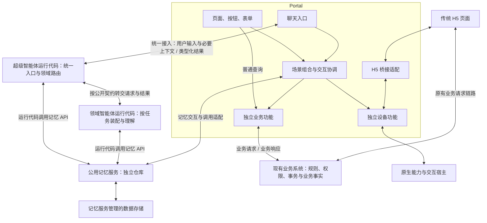

<!-- 此文件由 scripts/sync_architecture.py 生成，请修改规范源后重新同步。来源与章节见 source.json。 -->

## 2. 系统边界与职责

| 系统 | 职责 |
|---|---|
| Portal | 用户输入、选择和确认；设备操作；客户端草稿与交互状态；类型化业务请求的构造与发起；调用协调；业务结果展示 |
| 超级智能体 | 通过服务端运行代码统一承接 Portal 的自然语言交接，将请求路由到适合的业务领域 |
| 领域智能体 | 所属领域内的自然语言理解、意图识别和必要参数提取，将类型化结果交给 Portal |
| 公用记忆服务 | 管理跨会话记忆的存取、身份与访问范围、来源、版本和有效性；各调用方通过公开接口使用 |
| 现有业务系统 | 业务规则和权限的最终校验、事务、CRUD 的最终处理及业务事实保存 |
| 传统 H5 | 保持原业务页面、业务确认和业务请求链路；需要原生操作时通过桥接复用设备能力 |

Agent 不直接访问现有业务系统，不执行设备操作，也不承担确定性的业务流程。业务请求使用的认证信息由 Portal 的业务请求链路处理，不作为模型输入。

本文区分具体智能体、模型与服务端运行代码：具体智能体维护自己的指令、语义契约和评测；运行代码负责模型调用、校验、记忆接口调用及必要上下文装配。模型不自行决定访问权限或直接保存记忆。记忆服务管理平台记忆数据，业务系统仍负责最终业务事实。

Portal 的自然语言请求及必要续推理交接统一经过超级智能体的服务端路由代码，再转交对应领域智能体；类型化结果经同一路由返回 Portal。本文及模块文档中的“Portal → 领域智能体”“领域智能体 → Portal”描述内容的生产方与消费者，不表示客户端直连各领域服务。

本次领域已经明确时，由普通代码转交，不额外调用超级智能体模型；领域不明确或本轮输入改变领域指向时，按需识别或澄清。领域结果按契约转交 Portal，不交给超级智能体模型重新理解、改写或总结。普通转发只传递数据，不调用模型，因此不新增模型调用或模型 Token；领域理解、必要路由和续推理仍按实际模型调用统计。

统一入口将领域接入变化留在服务端，维护成本是领域路由、转发链路及公开契约兼容。具体运行宿主与部署接线由接入设计确定，路由由服务端普通代码实现。

Portal 的输入检查用于收集必要输入和构造合法请求，不能形成另一套业务规则。查询所得的业务数据也不能替代业务系统在提交时的最终判定。

智能体职责不额外要求独立部署。各领域是否接入自然语言交互、领域内的智能体组织及任务划分，由领域文档明确；功能独立不自动要求新增智能体。

超级智能体与领域智能体按已确认的仓库边界维护，通过公开契约协作，具体分仓见领域架构。记忆采用独立公用仓库、统一服务和版本化薄客户端；数据存储只由记忆服务维护，领域使用记忆不经过超级智能体代理。仓库与服务内部组织、契约发布及维护成本见公用记忆能力与服务架构。这一共享服务边界不要求其他每项功能都拆成服务。

