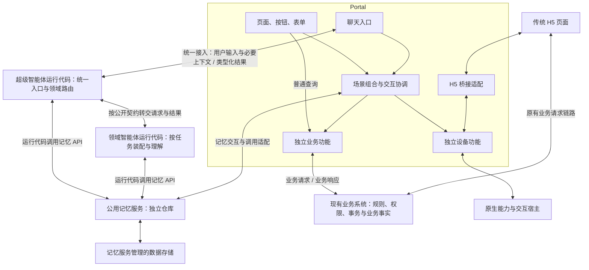

<!-- 此文件由 scripts/sync_architecture.py 生成，请修改规范源后重新同步。
来源：unif-platform-architecture/ARCHITECTURE.md
源文件 SHA-256：4f1912197c9cda8598d9ec05646982ae2744159e4b04c27b095c73765b156f59
相对文档链接已转为文字；领域材料由目标工程按需提供。 -->

# Unif 平台架构

本文只规定各业务领域共同遵循的系统职责、模块边界、契约、状态归属和工程验证原则，供各团队设计自己的领域架构。领域术语、业务功能、场景、具体接口约定和任务专属指令由领域文档维护，本文保留入口引用。

本文描述平台的目标架构。领域与模块设计、实现按可独立验收的业务链路逐步推进，每批明确必要契约和受影响消费者；具体迁移步骤在实施计划中维护。

## 1. 架构目标

平台通过独立功能和普通代码组合实现业务场景，使功能可以独立开发、组合复用和定向测试。

架构应降低模块之间的耦合、理解和修改一个功能所需的范围、验证变更的耗时，以及开发与业务运行中的模型上下文、调用次数和 Token 消耗。

模块首先是代码和测试边界。功能独立不要求独立部署，也不要求成为独立服务或智能体。新增公共抽象、通用机制或运行边界时，应说明实际问题、受益的消费者及维护成本。

架构成立的判断标准是：

- 修改一个功能，主要理解和修改该功能及必要依赖。
- 更换交互入口，核心功能和调用链路保持一致。
- 新增场景，优先组合已有功能。
- 修改单个任务，可以独立维护和评测，并识别必要的共享影响。
- 验证一个功能，可以替换外部依赖，并找到真正受影响的消费者。
- 确定性工作由代码完成，模型参与必要的理解和推理。
- 业务成功有明确的业务 `code` 依据。

### 1.1 设计依据与适用范围

从已确认的业务需要、系统职责和工程成本推导目标设计，正文直接定义新流程及其契约。业务场景依据用户确认和可复查的实际行为，不用假设补齐需求。历史实现用于核实产品行为、外部能力和环境限制，不决定新模块划分、命名、调用顺序或运行边界；参考事实与接入差异按第 9 节单独维护。

Portal 及 Agent、Channel、CLI 等相关工程都属于按新标准重新设计的范围。仓库、服务与部署按目标职责、消费者和维护成本确定，并遵循已确认的智能体组织方式。

本文的“现有业务系统”指承担最终规则、权限、事务和业务事实的系统。经业务方或接口契约确认的外部规则属于接入约束；客户端或中间层已有的处理方式不单独构成业务规则。外部能力不足以满足目标契约时，明确记录缺口及其影响，不由适配器伪造支持。

“代码是事实来源”表示代码证明实际实现，类型、运行时校验和模型 Schema 从可执行契约同源取得；设计中的字段、筛选规则和交互要求仍需业务或职责依据。已确认的新需求不要求旧代码已经实现；源码中的处理也不自动成为新需求。尚无依据的业务规则和外部能力保留为待确认项，不写成有效流程或用默认值补齐。

已授权范围内的内部组织、等价转换和必要验证，可以按工程判断推进。新增或改变用户可见行为、请求次数、副作用、状态归属或业务结果语义，须有已确认需求或契约依据；不能以“更稳健”“顺便完善”为由自行加入产品能力。缺失信息先通过相关契约和实际接口核实；确需产品选择时明确问题及影响，同时推进不依赖该选择的工作。

渐进式推进控制实施和验收范围。临时适配、替换顺序及结束条件由实施计划维护，与功能的长期职责分开。

## 2. 系统边界与职责



| 系统 | 职责 |
|---|---|
| Portal | 用户输入、选择和确认；设备操作；客户端草稿与交互状态；类型化业务请求的构造与发起；调用协调；业务结果展示 |
| 超级智能体 | 通过服务端运行代码统一承接 Portal 的自然语言交接，将请求路由到适合的业务领域 |
| 领域智能体 | 所属领域内的自然语言理解、意图识别和必要参数提取，将类型化结果交给 Portal |
| 公用记忆服务 | 管理跨会话记忆的存取、身份与访问范围、来源、版本和有效性；各调用方通过公开接口使用 |
| 现有业务系统 | 业务规则和权限的最终校验、事务、CRUD 的最终处理及业务事实保存 |
| 传统 H5 | 保持原业务页面、业务确认和业务请求链路；需要原生操作时通过桥接复用设备能力 |

Agent 不直接访问现有业务系统，不执行设备操作，也不承担确定性的业务流程。业务请求使用的认证信息由 Portal 的业务请求链路处理，不作为模型输入。

本文区分具体智能体、模型与服务端运行代码：具体智能体维护自己的指令、语义契约和评测；运行代码负责模型调用、校验、记忆接口调用及必要上下文装配。模型不自行决定访问权限或直接保存记忆。记忆服务管理平台记忆数据，业务系统仍负责最终业务事实。

Portal 的自然语言请求及必要续推理交接统一经过超级智能体的服务端路由代码，再转交对应领域智能体；类型化结果经同一路由返回 Portal。本文及模块文档中的“Portal → 领域智能体”“领域智能体 → Portal”描述内容的生产方与消费者，不表示客户端直连各领域服务。

本次领域已经明确时，由普通代码转交，不额外调用超级智能体模型；领域不明确或本轮输入改变领域指向时，按需识别或澄清。领域结果按契约转交 Portal，不交给超级智能体模型重新理解、改写或总结。普通转发只传递数据，不调用模型，因此不新增模型调用或模型 Token；领域理解、必要路由和续推理仍按实际模型调用统计。

统一入口将领域接入变化留在服务端，维护成本是领域路由、转发链路及公开契约兼容。具体运行宿主与部署接线由接入设计确定，路由由服务端普通代码实现。

Portal 的输入检查用于收集必要输入和构造合法请求，不能形成另一套业务规则。查询所得的业务数据也不能替代业务系统在提交时的最终判定。

智能体职责不额外要求独立部署。各领域是否接入自然语言交互、领域内的智能体组织及任务划分，由领域文档明确；功能独立不自动要求新增智能体。

超级智能体与领域智能体按已确认的仓库边界维护，通过公开契约协作，具体分仓见领域架构。记忆采用独立公用仓库、统一服务和版本化薄客户端；数据存储只由记忆服务维护，领域使用记忆不经过超级智能体代理。仓库与服务内部组织、契约发布及维护成本见公用记忆能力与服务架构。这一共享服务边界不要求其他每项功能都拆成服务。

## 3. 功能、场景与入口

### 3.1 独立功能

独立功能具有明确职责、必要的输入输出、错误和副作用，能够脱离具体页面、模型及真实外部系统进行验证。

| 功能类别 | 职责边界 |
|---|---|
| 数据查询 | 按条件读取数据；不替代用户选择，不决定后续业务场景 |
| 业务操作 | 针对明确输入执行业务请求，解释其结果；最终业务处理属于业务系统 |
| 定位 | 获取位置观测，表达权限、取消和设备错误；不判定业务准入 |
| 拍照 | 完成拍摄与照片选用，交付产物；业务归属、上传与提交由调用场景安排 |

功能通过小型类型化公共接口被使用。网络、设备等外部依赖由适配代码接入，使功能可以在测试中使用替代实现。具体接口形状在模块设计阶段定义。

功能内部的字段整理、结果投影和其他辅助处理，优先保留为普通函数。只有职责和消费者确实需要时，才扩大公共接口或抽出独立模块。

### 3.2 场景组合

场景使用普通代码组合功能，协调准备、选择、确认、提交和展示。具体场景使用哪些查询、设备和业务操作，由所属领域根据实际需要确定。

准备只收集输入、查询数据和取得所需设备产物。如果一个步骤会产生业务写入，必须明确表达其副作用和确认责任，不能隐藏为普通准备或查询。

场景决定调用顺序和必要的交互。两个功能共同完成一个目标时，由场景组合它们，避免通过相互调用形成循环依赖。

场景不自行提供跨业务请求的原子事务。多步业务中发生部分成功时，保留和展示各步真实结果；撤销、补偿或幂等能力以业务系统实际支持的契约为准。

### 3.3 交互入口与确认

页面按钮、表单和 AI 对话承担输入转换与交互适配。相同业务目标进入同一个场景协调过程，共用准备、确认和提交链路。

查询可以直接由入口调用并展示。H5 桥接只做必要的协议适配并复用设备功能，H5 的业务流程继续由原页面承担。

每个 Portal 场景维护针对具体提交内容的确认。入口动作已经明确表达目标、内容和副作用时，场景直接使用这次确认；只有内容变化或尚未确认时才补充交互，不因经过多个功能重复询问。确认可以由同一个按钮或明确的选用动作承担，不能由模型输出替代。

设备权限、照片选用和业务提交确认分别服务于不同操作。同一操作的确认不在入口、场景和 Agent 中重复维护。

## 4. 状态归属

| 状态或数据 | 维护方 | 使用原则 |
|---|---|---|
| 客户端草稿 | Portal 对应业务交互 | 入口读取和修改同一份草稿；模型只能基于必要片段提出类型化理解结果 |
| 选择、待确认内容和提交交互状态 | Portal 对应场景 | 状态推进由场景代码处理，入口展示其结果 |
| 当前任务线索与必要实体引用 | Portal 当前交互 | 用于选择任务内容及理解用户指代，不作为全局业务事实 |
| 会话原文、语言上下文和模型轮次 | Agent 会话 | 保存历史不等于每次模型调用加载全部历史 |
| 跨会话记忆 | 公用记忆服务 | 按归属、访问权限和适用范围读写；领域维护内容语义，调用方只持有所需快照 |
| 查询结果 | 业务系统提供事实，Portal 持有查询快照 | 页面、场景和必要的模型数据投影共同消费同一查询功能 |
| 最终业务事实 | 现有业务系统 | Portal 展示业务回执或查询结果；Agent 会话不能作为业务状态的判定依据 |
| 设备产物 | 交付前由设备功能管理，交付后由接收方管理 | 保留、转存和释放责任由使用场景明确 |

客户端交互状态与业务状态分别表达。请求已发送、界面关闭或模型声称成功，都不能代替业务事实。业务响应应接收至所属请求和交互，不能因入口切换而更新其他任务。

实体引用的范围和传递责任由领域或场景明确。需要跨任务承接时，使用类型化输入显式传递必要引用；其他交互的变化不能通过共享对象自动改写已有草稿或业务记录。候选数据、明确的交互选择与最终业务事实不能混为一份状态。

记忆不保存另一份权威草稿、当前选择或业务状态，也不将任务指令变成可由历史内容覆盖的规则。当前明确输入与交互引用按所属契约处理，历史记忆只提供有来源的线索；涉及业务实体时，仍须按当前业务契约核实。

## 5. 自然语言任务与上下文

### 5.1 通用指令与任务模块

接入自然语言入口的领域，以任务模块维护专属指令、代码定义的输入输出契约及独立评测样本；领域身份、共同术语和职责边界放在通用指令中。具体任务清单由领域文档维护。

| 内容 | 范围 |
|---|---|
| 通用指令 | 所属领域身份、共同术语、职责边界、引用和未知信息的处理原则 |
| 任务专属指令 | 当前任务的意图、参数、指代、修改含义及必要澄清 |
| 任务契约 | 本任务能够接收和输出的类型化内容 |
| 任务评测 | 本任务的意图理解、参数提取、引用、澄清和输出正确性 |

任务指令负责语义理解。用户选择、设备操作、流程推进、确认和业务提交由 Portal 代码完成。业务规则和最终权限判定不重复写入任务指令。

### 5.2 上下文装配

一次模型调用按需装配：

```text
通用指令
+ 当前任务指令
+ 当前任务需要的契约
+ 必要用户输入和会话上下文
+ 本次确有需要的受限记忆片段
```

入口已经指定任务，或本轮意图已经明确时，由普通代码选择对应任务内容。上一轮任务或 `taskHint` 本身不足以证明本轮意图；用户输入可能改变任务，应根据本轮表达选择所需内容，不能只因当前正在某个场景就沿用其指令。

任务不明确时，先识别意图，必要时澄清。明确任务不默认增加独立模型路由调用；模糊任务可以承担必要的识别或澄清成本，不承诺所有请求都能一次理解完成。

同时涉及多个任务时，只加载理解本次请求所需的任务内容。用户明确表达的先后关系可以被提取；实际执行顺序、交互和确认由 Portal 的已定义场景组合承担。尚未明确的执行关系不能交给模型自行决定。

每次调用不加载整个领域的全部指令、工具或历史数据。必要实体引用、相关草稿片段和必要原文按当前任务提供，业务凭证和无关业务数据不进入模型上下文。

记忆检索由当前调用方的普通运行代码按任务需要发起，先执行访问与适用范围过滤，再限制条目和字段。记忆不作为系统指令加载，也不要求每轮查询全部记忆或增加一个模型检索回合；详细交接见记忆能力文档。

### 5.3 查询与模型续推理

普通业务查询由 Portal 发起并直接展示。用户选择、确认和确定性的结果展示由代码完成。

当模型继续推理确实需要查询数据时，Agent 表达类型化数据需求，Portal 调用同一个查询功能，并限制返回模型的字段和数量。查询投影不维护另一套查询核心，有限候选也不能被解释为全部数据。

Portal 可以通过普通代码记录必要的结构化交互或业务结果，不要求模型再生成一轮确认或总结。

本节的业务数据查询与记忆检索分别遵循各自边界：智能体运行代码可以消费公用记忆 API，不因此获得直接访问业务系统的职责。Portal 使用记忆时复用同一记忆服务，不能在客户端维护另一套存取规则。

### 5.4 契约与评测同源

模型使用的 Schema 从代码契约取得。类型、运行时校验与模型 Schema 的语义保持同源，不在提示词中另行维护字段定义。具体技术实现由后续模块设计确定。

各任务分别维护评测样本，另保留必要的任务识别、任务切换和复合意图样本。评测数据用于开发验证；只有必要的少量示例进入任务指令。

修改单个任务指令时，验证该任务及相关共享样本。通用指令、共同术语、共享契约或装配方式变化时，扩大到受影响任务。结构合法、语义准确和业务合法性分别验证，不能互相替代。

## 6. 跨边界交接与业务结果

### 6.1 交接原则

| 方向 | 交接内容 | 接收责任 |
|---|---|---|
| Portal → Agent | 用户输入、任务线索、必要引用及上下文 | 校验输入并装配相关任务 |
| Agent → Portal | 类型化意图、必要澄清或受限数据需求 | 校验结构和引用，进入对应场景或交互 |
| Portal → 业务系统，查询 | 类型化查询条件 | 业务系统校验权限并返回查询结果 |
| Portal → 业务系统，写入 | 准备完整、具备相应确认依据的类型化业务请求 | 业务系统最终校验并执行 |
| 业务系统 → Portal | 业务码、对应状态和结果数据 | 对应功能解释响应，场景展示并处理结果 |
| Portal → Agent，必要续推理 | 受限的查询数据或明确的查询失败 | 仅在仍需理解或推理时继续模型调用 |
| 智能体运行代码或 Portal → 记忆服务 | 授权上下文、明确的读取或写入请求 | 服务端校验身份、访问范围、操作及必要内容 |
| 记忆服务 → 调用方 | 类型化结果、写入操作关联、必要记忆内容和版本 | 校验响应和请求归属，按记忆契约区分读取无匹配、写入受理与完成、失败、冲突及未确认结果 |

网络、H5 和模型输出等边界进行必要的运行时校验。模型输出必须由 Portal 接收和验证，不能直接变成业务请求或业务事实。

功能公共契约由平台根据职责和消费者需要定义。业务系统的原始请求、响应契约由对应系统维护，两者通过适配器连接：

```text
页面／场景 → 功能公共契约 → 适配器 → 后端原始请求契约
页面／场景 ← 功能类型化结果 ← 适配器 ← 后端原始响应契约
```

适配器负责请求字段转换、业务码校验与解释、数据读取和结果映射，属于 Portal 调用链路中的普通实现代码。消费者依赖已确认的功能契约，不直接解析后端信封、具体成功码或原始错误文本。已有业务数据结构适合消费者时，可以将其字段和语义确认为公共数据契约，不要求仅为分层改名；此后由所属契约维护方控制变化，真实接口差异仍在适配边界处理。业务能力不变时，后端字段或包装结构变化主要修改适配器及其契约测试。

转换必须有明确的外部契约依据。字段改名、数组包装等确定性差异可映射；缺少业务码或码无法识别时，不能猜测成功。成功码已明确时，数据缺项不改变接口成功结果；展示字段按空显示，后续请求需要的身份或业务参数仍从实际数据取得，不编造。适配器不能补出业务系统未提供的能力。改变写请求数量、执行顺序或结果范围时，先定义对应能力或场景的输入、确认与结果，不能作为字段适配的内部选择。

每份契约的类型、运行时校验和需要的 Schema 保持同源。功能契约与后端原始契约各自表达不同边界，不因要求同源而合并成一份。原始协议类型留在适配边界，模型按需取得功能语义契约；不新增通用转换引擎或运行时插件系统。

公共传输代码负责传输和认证等技术事项。各业务接口的码表由对应适配器按明确约定解释，不能在公共传输层猜测；页面、场景和 Agent 不再各自解析一次后端业务码。

### 6.2 业务成功的依据

每个外部业务接口必须明确业务 `code` 的类型、成功码、明确失败码及其他状态的含义，并定义各状态所需的数据。具体响应结构与码表属于对应领域和适配器的原始接口契约，平台不统一指定某个领域的信封或成功码。

原始数据可按具体接口约定为数组、对象、字符串、布尔值、数字等，接收后按用途读取。接口是否成功只按业务码判断；`data` 的字段、空值和类型用于展示或业务条件判断，不作为另一道接口成功门槛。不能通过 `if (!data)` 判定接口失败，也不能通过非空数据或结果说明文字判定接口成功。

功能公共契约按需要表达成功数据、取消、业务拒绝或结果未确认等语义，不照搬后端信封。

Portal 适配器根据原始接口的业务 `code` 判定并映射结果。原始码及请求关联保留在该请求的结果解释和请求诊断记录中，供验证与排查；功能消费者使用映射后的语义，不再比较后端的具体成功码。HTTP 成功、存在 `data`、返回业务 ID 或请求已发出，都不能代替业务成功码。不同类型的码是否等价，由外部接口契约决定，不能擅自转换。

| 情况 | 处理原则 |
|---|---|
| 已知成功码 | 按接口成功处理；缺少展示字段或回执内容不改判失败 |
| 已知业务失败码 | 按明确业务失败处理 |
| 已知其他状态码 | 按该接口定义的状态处理 |
| 写请求超时、响应缺码或码无法识别 | 无法确认结果时，不推断成功或确定失败 |
| 成功码下，接口的 `data` 表达准入等业务条件 | 按该条件的明确含义继续判断；条件不满足不等于接口调用失败 |

列表保留接口数组中的全部条目和顺序，字段缺失按空展示，不因一条缺值拒绝整页、剔除记录或增加异常计数。读取视图允许实际可能缺失的字段，包括嵌套字段；原始数据契约仍描述接口应提供的内容，不能用全对象校验把缺值行拒绝掉。展示用的空值不充当业务身份，发起后续操作时仍检查其必要输入。

成功响应中的实际空数组表示本页无记录；若根本没有可读取的列表数据，只展示暂无列表数据，不推断业务无匹配。成功结果缺少后续需要的数据时，可用可选字段表达；不另设通用的“成功但回执异常”状态，也不重新提交已成功的写入。传输失败、缺码与未知码仍不能被当作成功。

### 6.3 取消、失败与未确认结果

准备或确认阶段取消，由 Portal 停止后续步骤并处理所属临时资源。设备和查询失败如实表达，不编造替代数据。

写请求发出后取消等待，不代表业务已撤销。结果无法确认时，Portal 保留必要请求关联，按业务系统实际提供的能力查询或核实；没有核实能力时，明确展示结果未确认。

重复提交防护和业务幂等是不同责任。是否重试，以及是否支持幂等、撤销或恢复，由实际业务契约和场景要求决定。

### 6.4 契约标识与用户文案

契约字段名、状态值和错误标识使用稳定的代码命名，例如 `entityId`、`success`、`cancelled`、`timeout`。这些标识用于程序协作，不直接作为界面文案。

公共能力名称由职责、输入输出和关键副作用确定，区分只读查询、可能写入的操作与场景组合。已有目标契约时保持命名和语义一致；未确认的接口标为设计候选。示例和评测材料不能代替目标模块契约或真实源码证据。

手写 TypeScript 契约中的对象结构使用 `interface`，包括输入、输出、错误分支和参数对象；对象扩展使用 `extends`。`type` 用于基本类型别名、字面量集合、已命名接口的联合及推导类型，不直接声明对象结构。成功、失败、取消等结果分别定义接口，再用联合类型保留互斥分支及必填字段约束。由运行时 Schema 生成或推导的类型直接使用其产物，不为书写风格另行手写一份接口。

Portal 的按钮、标签、确认、结果和错误提示，以及面向用户的 Agent 解释、澄清，统一使用简体中文。业务实体名称等原始数据保留真实内容，不为中文展示改写业务事实。

原始业务接口契约明确 `message` 是否保证为可直接展示的中文业务说明。功能确实需要该说明且外部约定满足要求时，由适配器转换为功能契约定义的用户提示；否则由所属交互根据功能错误类型提供中文提示。原始 `message`、英文异常和技术堆栈不直接穿透到界面，文案也不改变业务结果分类。

中文提示映射保留在所属功能的交互代码中，供不同入口复用；只在确有共同语义时共享。当前无需引入多语言框架，也不为普通结果展示或错误翻译增加模型调用。验证时检查用户实际看到的中文及其业务含义，不能只断言内部英文状态。

## 7. 独立开发与验证

### 7.1 依赖治理

基本依赖关系为：

```text
交互入口 → 场景组合 → 独立功能 → 外部适配
```

应用组装代码提供具体依赖。功能不反向依赖页面、聊天展示或场景内部状态；跨功能协作优先放在组合代码中。

平台公共能力不反向依赖某个领域的私有实现。跨领域协作通过明确的公开契约与组合代码完成，不穿透领域内部状态；真实复用需求出现时，再评估是否提取公共能力及其维护成本。

公共契约保持精简，只共享具有稳定共同语义的内容。草稿和业务进度留在所属场景，不汇入一个覆盖所有任务的公共状态对象。

使用类型检查、导入约束、静态引用分析和现有测试工具识别消费者。任务指令引用、跨系统契约和 H5 协议等静态 import 不能完整覆盖的关系，补充少量明确的对应关系，服务于检查和测试选择。

契约变化时，识别生产方、消费者和相关组合链路，验证结构与语义影响。跨部署版本的兼容范围由实际发布约束确定，不默认为各端同时升级。

公用记忆仓库维护自己的可执行公共契约、服务实现及按需生成的类型和薄客户端，各消费仓库锁定所用版本。消费者契约验证补充跨仓依赖关系；不直接导入其他仓库私有源码、共写记忆数据表或复制手写 Schema。领域内容契约的归属与公共接口分开，按记忆文档约定协作。

### 7.2 测试责任

| 验证范围 | 证明内容 |
|---|---|
| 单功能验证 | 真实功能在替代外部依赖下的输入输出、错误及副作用 |
| 场景组合验证 | 准备、选择、确认、调用顺序和结果处理 |
| 入口与接线验证 | 页面和聊天进入同一链路，真实依赖已经接入 |
| 模型任务评测 | 意图理解、参数提取、澄清、任务切换及类型化输出 |
| 集成与业务系统验证 | 实际接口语义、权限、事务、码表及最终业务事实 |
| 真机验证 | 设备权限、原生宿主、设备操作及产物生命周期 |

测试真实被测功能，替换网络、设备等外部边界。断言返回和状态，也断言不应发生的提交或其他副作用。模拟模型输出不能证明理解准确，结构校验不能证明业务成功。

本地快速验证按影响范围执行。系统合并和发布按实际 CI 配置完成 required 验证，定向测试不能替代完整门禁；同一验证阶段避免重复执行相同测试。

### 7.3 变更影响

| 变化 | 验证范围 |
|---|---|
| 后端字段或响应包装变化，业务语义不变 | 原始协议校验、适配映射测试及必要联调；确认仍产出相同功能契约，不要求所有页面改动 |
| 功能内部变化 | 本功能及实际受影响的适配、消费者和组合 |
| 单个任务指令变化 | 该任务评测，必要的识别、切换和复合意图样本 |
| 共享契约或通用指令变化 | 受影响的生产方、消费者、任务和场景 |
| 共享状态变化 | 相关读写者、任务切换及异步结果交接 |
| 记忆公共接口、权限或生命周期变化 | 实际调用方的契约与相关组合；检索结果或装配语义受影响时补对应任务评测 |
| 设备适配变化 | 设备功能、相关场景和 H5 消费者；涉及原生行为时补真机验证 |

影响范围无法完整确定时，扩大到相关领域及集成链路，并补齐遗漏的依赖关系。完整验证发现的漏测问题用于修正定向选择规则。

### 7.4 设计交付的最小依据

设计说明按本次变化提供可检查的依据，不规定固定目录、文件模板或每函数一份文档：

- 能力、场景和入口各自承担什么，哪些处理仍为内部普通函数；每个额外字段、状态、交互或调用对应哪个已确认需要和实际消费者。
- 场景每一步对应哪个公共能力，前一步输出能否满足下一步输入；查询不能借用有创建副作用的操作补齐身份。
- 各结果状态能否由真实数据构造，接收者如何处理；文字描述、类型的必填／可选约束与验收样本必须一致。用于展示的空值不能补成业务身份或已满足的条件。
- 谁维护草稿、确认、请求与业务事实，取消或迟到结果仍归属于谁；普通调用可由参数、返回值和局部状态完成时，不额外要求公共关联标识或运行机制。
- 外部依赖如何替换、谁实际消费该契约、优先验证哪些行为，以及什么变化需要扩大验证。

已有契约覆盖且公共语义不变的内部调整，引用对应依据和已有验证即可，不重复设计完整模块。设计定义验收范围，交付时提供实际执行证据；类型示例通过检查不能代替场景交接和业务语义审查。

## 8. 成本与效果验证

| 目标 | 架构手段 | 观察指标 |
|---|---|---|
| 缩小变更范围 | 小型公共接口、功能内部实现独立、场景组合复用 | 人工维护文件数、涉及模块数、跨模块修改比例 |
| 减少开发上下文 | 按功能理解实现和契约，明确真实消费者 | 实际阅读文件及契约数量、提供给模型的上下文 Token |
| 缩短验证时间 | 替换外部依赖、定向测试、按证据分层 | 测试套件数、冷暖耗时、失败定位时间及漏选问题 |
| 保持任务理解质量 | 任务独立维护，覆盖必要共享影响 | 意图、参数、引用、修改含义、澄清及整任务输出正确率 |
| 降低模型成本 | 按任务装配、代码完成确定性工作、限制数据回传 | 一次用户目标累计模型调用数、总输入输出 Token、端到端延迟 |

以相同业务行为和验收标准比较代表性变更。生成文件与人工维护文件分别统计；模型成本包含路由、澄清和续推理产生的调用，不能只计主要调用。缺少用量数据时标明未知。

端到端延迟同时区分系统处理时间与用户选择、确认的等待时间。准确性、调用次数和耗时结合评估，不能以漏掉必要判断或缩小测试范围换取更低数字。

上述收益属于设计目标。实际降幅、准确率和耗时必须在实现后测量，架构定稿本身不证明成本已经降低。

## 9. 领域与模块文档

文档按责任分工维护，不预建完整业务目录或固定文件模板：

文档层次本身不决定代码目录、服务数量或部署边界；已经确认的仓库与服务边界按对应架构执行。

| 文档 | 维护内容 |
|---|---|
| 平台架构（本文） | 跨领域共同遵循的系统职责、契约与适配、状态、模型参与边界和工程原则 |
| 领域架构 | 本领域的术语、功能与场景、任务组织、状态交接、外部业务约定及验收 |
| 功能模块文档 | 本功能的职责、公共契约、适配依赖、错误与副作用、确认责任、消费者、定向验收及必要的设计理由 |

架构和模块正文维护当前有效的目标行为、契约、关键约束和验收要求。必要的历史流程、源码证据、接入差异及未决问题放在独立辅助文件中，正文按需引用；迁移安排由实施计划维护。讨论经过、当轮授权和执行进度默认留在会话中。

阅读依据记录实际核对的仓库版本、入口与关键函数、请求与响应含义、状态和副作用，以及证据覆盖范围。测试定义、实际运行和业务方确认分别标明；只读到客户端构造或测试替身时，不据此宣称后端已支持。后续从所属资料定位代码并核对版本，不能凭会话摘要补造未记录的结论。

契约尚未定稿时，在对应位置简短标为草案并关联具体问题。草案中已明确的行为和字段按当前定义评审，未决部分只影响依赖它的实现；不能因标为草案就自行替换已定语义。结论明确后改写所属规范及受影响消费者，移除已解决的待确认项。已有辅助文件能够承载接入依据时直接复用，不为每次讨论新增文件或规则清单。

实现范围由本次交付所采用的已确认需求和契约界定。架构中列出的能力、示例、未来扩展和待确认项，不表示每批都要全部实现；涉及的契约尚不完整时，先补齐该交接，不根据能力名称推造接口、默认行为或配套系统。实现与测试逐项对应所采用的目标行为，源码和测试中的额外行为也须有需求依据。

其他团队编写领域架构时，明确本领域的职责和外部系统、功能及组合链路、状态与确认归属、必要的自然语言任务、业务接口约束及验证范围。区分已确认需求、实现事实、工程设计及待确认项；示例和评测只验证已定义语义，不据此新增业务需求。通用规则引用本文，不在领域文档中复制另一套平台规范。

模块设计按实际场景逐步展开，具体接口、草稿结构和恢复方式在相应文档中确定。实现后代码与可执行契约为事实来源，文档解释职责和关键语义，不另行手写维护重复的 Schema。

Agent、Channel、CLI 等工程的技术设计按重新确认的职责展开，引用本平台标准；实现语言、服务内部结构和部署细则在需要时补充。若发现共同标准本身需要调整，评审并更新本文及受影响契约，不以某个旧工程另建一套相互冲突的职责标准。

领域专属需求在领域文档维护。涉及系统职责、共享契约或多个领域的变化时，先识别消费者和架构影响，再同步相关文档与验证；不能把单个领域的做法自动升级为平台规则。

已建立的领域文档：

- 营销架构：本领域的功能、场景、智能体任务、客户引用、业务接口约定及模块入口。

已建立的公用能力文档：

- 公用记忆能力与服务架构：独立公用仓库与服务、公共能力、数据归属、版本化契约及跨仓验证。
- Portal 基础能力架构：客户端现有基础能力的完整边界、组合、资源归属与定向验证。

已建立的工程组织文档：

- Portal 工程目录与基础代码组织：客户端目标目录、基础组件复用、工具与常量和类型归属、依赖方向及定向验证。
- Portal 文件开发规则：各类代码的开发要求、常量与类型拆分、变量作用域、命名及技能和工程检查的执行入口。

后续领域按实际需要建立各自架构文档，在此增加入口。领域内容增长由领域与模块文档承载，平台总文档继续维护共用原则。
