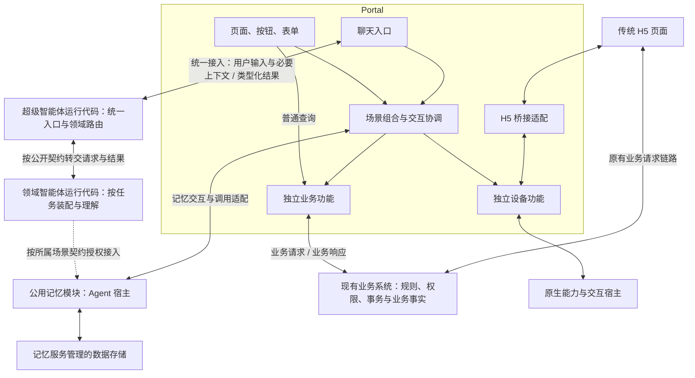

<!-- 此文件由 scripts/sync_architecture.py 生成，请修改规范源后重新同步。来源与章节见 ../source.json。 -->

## 2. 系统边界与职责

图中虚线表示按所属场景契约授权的可选调用关系；实际已接线的调用方按对应契约和状态表核对。超级路由转交原输入与候选，记忆模块使用 Agent 宿主不赋予路由检索职责。

| 系统 | 职责 |
|---|---|
| Portal | 用户输入、选择和确认；设备操作；客户端草稿与交互状态；类型化业务请求的构造与发起；调用协调；业务结果展示 |
| 超级智能体 | 通过服务端运行代码统一接收 Portal 的用户输入与必要上下文，将请求路由到适合的业务领域 |
| 领域智能体 | 所属领域内的自然语言理解、意图识别和必要参数提取，经统一入口交付类型化结果 |
| 管理后台 | 查看异常、核实结果并在权限内继续所属服务保存的原业务请求；使用当时固定参数，不重新调用模型或按新记忆匹配，也不代理业务规则 |
| 公用记忆服务 | 管理跨会话记忆的存取、身份与访问范围、来源、版本和有效性；各调用方通过公开接口使用 |
| 现有业务系统 | 业务规则和权限的最终校验、事务、CRUD 的最终处理及业务事实保存 |
| 传统 H5 | 保持原业务页面、业务确认和业务请求链路；需要原生操作时通过桥接复用设备能力 |

Agent 负责理解、路由和执行控制。设备操作、业务确认和业务请求由 Portal 发起，业务系统负责最终权限、事务和业务回执。业务凭据留在发起请求的适配层。

本文区分具体智能体、模型与服务端运行代码：具体智能体维护自己的指令、语义契约和评测；运行代码负责模型调用、校验、按所属场景契约调用记忆接口及必要上下文装配。模型不自行决定访问权限或直接保存记忆。记忆服务管理平台记忆数据，业务系统仍负责最终业务事实。

Portal 的自然语言请求及必要续推理交接统一经过超级智能体的服务端路由代码，再转交对应领域智能体；类型化结果经同一路由返回 Portal。本文及模块文档中的“Portal → 领域智能体”“领域智能体 → Portal”描述内容的生产方与消费者，不表示客户端直连各领域服务。

普通聊天先由超级智能体模型判断自行回复、澄清用途或交给哪个已接入助手；领域内部的业务识别、字段提取、匹配和任务指令由对应助手负责。已确认的显式入口只确定目标助手，不让超级智能体预选领域业务 Skill。请求沿原来源交接文字、附件解析正文、相关历史和调用方已准备的资料；接入层不补造业务事实、不承担业务处理。领域结果按契约直接交给 Portal，不再由超级模型改写。实际模型步骤、调用次数和用量按当前领域契约记录，不能根据目录或固定层数推算，未知用量不填零。

统一入口将领域接入变化留在服务端。各助手接入登记路由说明和委派工具，负责本助手的资料交接、协议校验与通信。路由说明可以是正文，也可以引用 Agent 路由提示词中的专属小节。通用路由和执行通过显式装配使用各助手的接口，模型只取得本次已注册助手的说明和可用工具。接入认识领域及其协议属于平台职责，订单、拜访、报销等业务判断仍归所属领域。普通函数、明确映射或小型接入对象即可承担当前组合；不因预期未来助手而建立动态工具框架、独立注册服务、空实现或兼容层。具体目录采用目标工程规范。

运行交接、受理与终态见Agent 运行契约（规范源相对路径：`runtime/agent-runtime.md`），会话数据见对话服务（规范源相对路径：`runtime/conversations.md`），通道的认证、格式与事件流转换见通道接入（规范源相对路径：`runtime/channel.md`）。这些文档维护各自输入输出和接线，不把领域业务细节追加到平台总文档。

Portal 的输入检查用于收集必要输入和构造合法请求，不能形成另一套业务规则。查询所得的业务数据也不能替代业务系统在提交时的最终判定。

智能体职责不额外要求独立部署。各领域是否接入自然语言交互、领域内的智能体组织及任务划分，由领域文档明确；功能独立不自动要求新增智能体。

超级智能体与领域智能体按已确认的仓库边界维护，通过公开契约协作，具体分仓见领域架构。记忆采用独立逻辑模块、API、数据库和版本化薄客户端，当前由 ai-app-agent 现有宿主承载；记忆读取调用方及采用的公开接口由所属场景契约确定，不能从领域名称推定直接调用；消费者不绕过记忆服务访问数据表，超级智能体的路由与执行协调不代理检索。仓库与服务内部组织、契约发布及维护成本见公用记忆能力与服务架构（规范源相对路径：`capabilities/memory.md`）。逻辑边界不要求每项功能分别部署服务。
