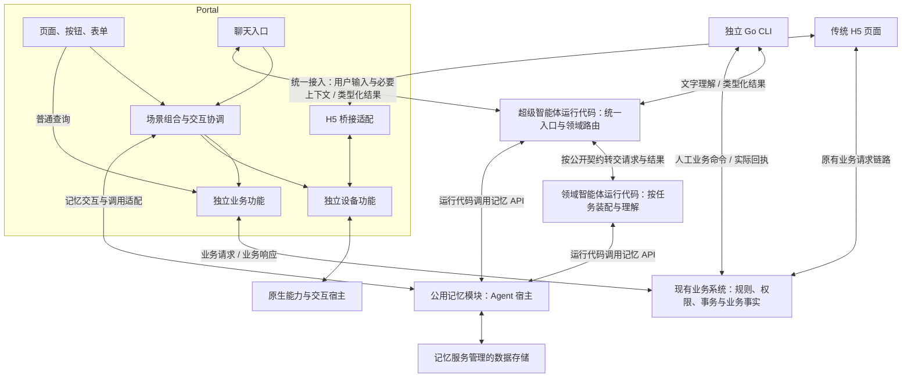

<!-- 此文件由 scripts/sync_architecture.py 生成，请修改规范源后重新同步。来源与章节见 ../source.json。 -->

## 2. 系统边界与职责

| 系统 | 职责 |
|---|---|
| Portal | 用户输入、选择和确认；设备操作；客户端草稿与交互状态；类型化业务请求的构造与发起；调用协调；业务结果展示 |
| 超级智能体 | 通过服务端运行代码统一承接 Portal 与 CLI 的自然语言交接，将请求路由到适合的业务领域 |
| 领域智能体 | 所属领域内的自然语言理解、意图识别和必要参数提取，经统一入口交付类型化结果 |
| 独立 Go CLI | 人工业务命令直接调用所属业务系统；理解命令使用统一入口并交付结果。与两服务端整体设计，独立维护和分发 |
| 管理后台 | 查看异常、核实结果并在权限内继续所属服务保存的原业务请求；使用当时固定参数，不重新调用模型或按新记忆匹配，也不代理业务规则 |
| 公用记忆服务 | 管理跨会话记忆的存取、身份与访问范围、来源、版本和有效性；各调用方通过公开接口使用 |
| 现有业务系统 | 业务规则和权限的最终校验、事务、CRUD 的最终处理及业务事实保存 |
| 传统 H5 | 保持原业务页面、业务确认和业务请求链路；需要原生操作时通过桥接复用设备能力 |

Agent 不直接访问现有业务系统，不执行设备操作，也不承担确定性的业务流程。业务凭据由发起请求的 Portal 或人工 CLI 接入处理，不作为模型输入。三个工程的交接共同核对，详细契约按所属功能维护；CLI 不作为服务端的执行器或部署依赖。

本文区分具体智能体、模型与服务端运行代码：具体智能体维护自己的指令、语义契约和评测；运行代码负责模型调用、校验、记忆接口调用及必要上下文装配。模型不自行决定访问权限或直接保存记忆。记忆服务管理平台记忆数据，业务系统仍负责最终业务事实。

Portal 的自然语言请求及必要续推理交接统一经过超级智能体的服务端路由代码，再转交对应领域智能体；类型化结果经同一路由返回 Portal。本文及模块文档中的“Portal → 领域智能体”“领域智能体 → Portal”描述内容的生产方与消费者，不表示客户端直连各领域服务。

普通聊天先由超级智能体模型理解：普通问题自行回复，营销业务按完整语义选择任务并委派唯一已接入的营销助手。符合第 5 节显式订单条件的输入由服务端运行代码直接交给订单任务，不调用路由模型。两条路径均原样交接本轮输入、任务线索、附件和必要上下文，不用关键词预判业务，也不由超级模型编造业务结果。营销结果按契约直接交给 Portal，不再调用超级模型改写或总结。普通自答通常一次模型调用，普通委派通常为超级模型加营销模型两次；显式订单省去路由调用，供数、候选匹配和明确补充的实际调用另计，未知用量不填零。

统一入口将领域接入变化留在服务端；普通聊天由模型负责自答或委派的语义决定，运行代码验证显式任务条件、允许的委派、原输入来源、输入范围、取消与终态。当前不建立领域注册中心、动态工具框架或旧协议兼容层。

运行交接、受理与终态见Agent 运行契约（规范源相对路径：`runtime/agent-runtime.md`），会话数据见对话服务（规范源相对路径：`runtime/conversations.md`），通道与命令入口见Channel／CLI（规范源相对路径：`runtime/channel-cli.md`）。这些文档维护各自输入输出和接线，不把领域业务细节追加到平台总文档。

Portal 的输入检查用于收集必要输入和构造合法请求，不能形成另一套业务规则。查询所得的业务数据也不能替代业务系统在提交时的最终判定。

智能体职责不额外要求独立部署。各领域是否接入自然语言交互、领域内的智能体组织及任务划分，由领域文档明确；功能独立不自动要求新增智能体。

超级智能体与领域智能体按已确认的仓库边界维护，通过公开契约协作，具体分仓见领域架构。记忆采用独立逻辑模块、API、数据库和版本化薄客户端，当前由 ai-app-agent 现有宿主承载；领域直接调用记忆接口，超级智能体运行逻辑不代理检索。仓库与服务内部组织、契约发布及维护成本见公用记忆能力与服务架构（规范源相对路径：`capabilities/memory.md`）。逻辑边界不要求每项功能分别部署服务。
